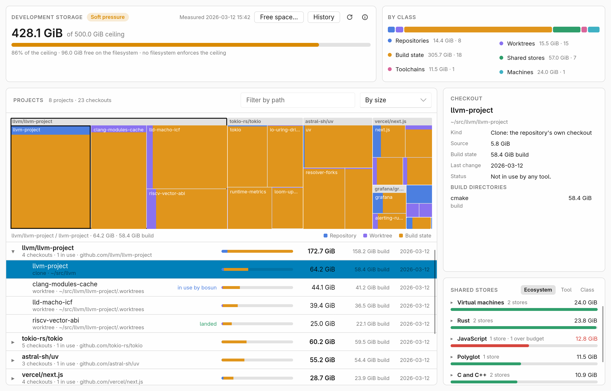

# Suds

**A workstation storage manager for agentic development.**

[](https://github.com/pithecene/suds/releases/latest)
[](https://github.com/pithecene/suds/actions/workflows/ci.yml)
[](LICENSE)

Suds measures the storage that development leaves on a workstation and
holds it to a ceiling. It finds each Git checkout, the build output
beneath it, and each shared store and toolchain. Suds removes build output
that no process uses and trims each store to a budget. Each removal runs
through a plan that a person approves, or that the owner's settings
approve in advance. Agents that work in many worktrees fill a disk within
days, and Suds bounds that growth.



The picture shows an invented workstation, from the reading in
[`docs/assets/reading.json`](docs/assets/reading.json).

---

## Installation

Each release holds an archive of the `suds` command for macOS on Apple
silicon and for Linux on x64 and arm64. With [mise](https://mise.jdx.dev/),
one command installs the newest release:

```sh
mise use -g github:pithecene/suds
```

An archive for Linux holds the desktop application too.
[The desktop guide](docs/guides/desktop.md) describes how its script adds
the application to the desktop's menu.

---

## Quick Start

```sh
# Measure each checkout beneath a workspace, with its build output and the shared stores.
suds inspect --profile development --root ~/workspace

# Save a plan for the removal of build output that no process uses. The plan removes nothing.
suds reclaim --root ~/workspace --save

# Remove what that plan names.
suds reclaim --apply PLAN

# Plan each shared store's trim to its budget, then run the trims.
suds stores
suds stores --apply

# Plan the schedule that runs `suds maintain`, then place it.
suds schedule --install
suds schedule --install --apply
```

Each command that changes the disk prints its plan first and changes
nothing without `--apply`. The journal records each run, and
`suds journal` lists the runs.

---

## Capabilities

- **Measures development storage**: the `suds inspect` command reports each
  checkout, its build output, and each shared store, toolchain, and virtual
  machine, as a table or as one JSON document →
  [inspection guide](docs/guides/inspect.md)
- **Reclaims build output**: the `suds reclaim` command removes build state
  that its ecosystem's layout proves and that no process uses. It also
  removes a linked worktree that Git finds clean and that a remote holds →
  [reclamation guide](docs/guides/reclaim.md)
- **Seeds a new checkout's build state**: the `suds seed` command clones
  the Cargo build state of a built checkout into a new one. A clone shares
  its blocks with its source, so it occupies almost no space →
  [seeding guide](docs/guides/seed.md)
- **Holds stores to budgets**: the `suds stores` command trims the stores of
  Go, pnpm, ccache, mise, and Docker through each store's own program →
  [store budgets guide](docs/guides/stores.md)
- **Keeps a ceiling without a person**: the `suds maintain` command
  measures on a schedule and records the pressure against the ceiling. A
  client registers the checkouts that it works in, and Suds removes
  nothing beneath them →
  [clients and schedule guide](docs/guides/maintenance.md)
- **Reports the ceiling**: the `suds arena` command states the ceiling of
  development storage and whether a filesystem enforces it →
  [arena guide](docs/guides/arena.md)
- **Moves entries through a plan**: the `suds plan`, `suds apply`, and
  `suds undo` commands move a directory's children and return them →
  [moves guide](docs/guides/moves.md)
- **Shows the workstation in a window**: the desktop application draws the
  pressure, a storage map of each project, and the stores. It plans a
  reclaim for a person's approval and lists the journal's runs →
  [desktop guide](docs/guides/desktop.md)

---

## Guarantees

- **No change without a plan**: Suds moves an entry, removes a directory,
  or clones build state only through a recorded plan, and it copies and
  overwrites nothing. It deletes only what a recorded reclaim plan names.
- **A journal of each run**: the journal records each step of each run, and
  the `suds undo` command returns each entry that a run moved.
- **Each store's own program**: Suds removes no entry of a store itself.
  Go, pnpm, ccache, mise, and Docker each trim their own store.
- **Metadata alone**: Suds reads metadata and directory listings, and it
  reads no extended attribute. The development profile opens the `.git`
  file of each linked checkout, and no other inspection opens a regular
  file. The `seed` command compares the `Cargo.lock` of two checkouts and
  clones the files of build state.
- **No network and no privilege**: Suds sends no telemetry, makes no
  network request, and never requests elevated privileges.
- **No system path**: the default profile holds no system-owned path. For
  an explicit root, Suds reads only the path that the caller names, with
  the caller's own permissions.

A report can reveal private file and directory names, so treat it as local
machine data. Suds makes no claim about machine performance: optimization
here means a measured reduction in storage use. [AGENTS.md](AGENTS.md)
states the rules that bind each operation that changes a file.

---

## Documentation

| Topic | Where |
| :--- | :--- |
| The `suds inspect` command, its profiles, and its JSON document | [Inspection guide](docs/guides/inspect.md) |
| Removing build output and landed worktrees | [Reclamation guide](docs/guides/reclaim.md) |
| Seeding a new checkout's build state | [Seeding guide](docs/guides/seed.md) |
| Budgets of the shared stores | [Store budgets guide](docs/guides/stores.md) |
| The registry of clients, the pressure, and the schedule | [Clients and schedule guide](docs/guides/maintenance.md) |
| The ceiling and its enforcement | [Arena guide](docs/guides/arena.md) |
| Moves, the journal, and undo | [Moves guide](docs/guides/moves.md) |
| The desktop application | [Desktop guide](docs/guides/desktop.md) |
| Decisions and their reasons | [`docs/decisions/`](docs/decisions/) |
| Building and testing Suds | [`CONTRIBUTING.md`](CONTRIBUTING.md) |
| Each release | [`CHANGELOG.md`](CHANGELOG.md) |

---

## Status

Suds is under active development, and a release may change a command or a
file format.

- The `suds` command runs on macOS on Apple silicon and on Linux on x64
  and arm64.
- The desktop application runs on Linux. Decision
  [0005](docs/decisions/0005-macos-window.md) proposes a native window for
  macOS, and no release holds one.

---

## License

Pithecene LLC distributes Suds under the Apache License 2.0 (see
[`LICENSE`](LICENSE)). Copyright © 2026 Pithecene LLC.

Pithecene answers inquiries at contact@pithecene.sh.
[`SECURITY.md`](SECURITY.md) describes the procedure for reporting a
vulnerability.
